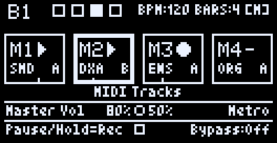
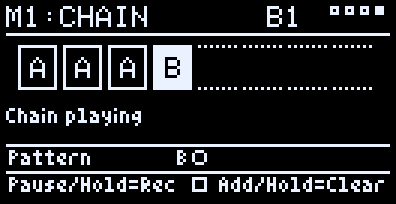
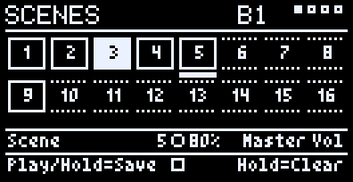
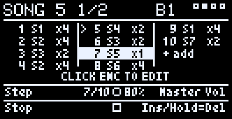
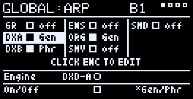
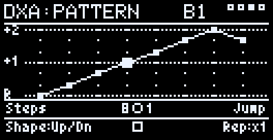
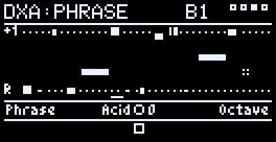
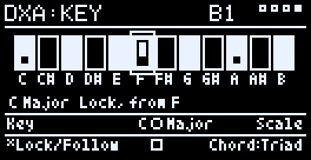
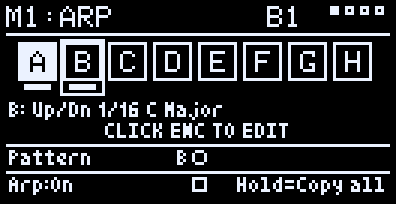

> **🧪 In active testing.** This project is changing quickly, so new
> releases will come thick and fast. Suggestions, bug reports and ideas
> for changes are very welcome — please [open an
> issue](https://github.com/Peteranthony1st/PZD-Daisy-Pod-Groovebox/issues)
> or start a discussion.

<p align="center">
  
  &nbsp;
  
  &nbsp;
  
</p>
<p align="center">
  
  &nbsp;
  
</p>

<p align="center">
  <a href="https://www.youtube.com/watch?v=ENl2P4_RopY">
    
  </a>
  <br />
  <b><a href="https://www.youtube.com/watch?v=ENl2P4_RopY">▶ Watch the v3.0.0 overview on YouTube</a></b>
</p>

Video and looper generated WAV file below!

# PZD-Daisy-Pod-Groovebox

A pocket, **multitimbral** groovebox for the [Electrosmith Daisy
Pod](https://daisy.audio/products/pod): a 4-track stereo looper, seven
synth/sampler engines and an **8-track MIDI sequencer**, every engine
playable together at the same time on one small board — not
one-at-a-time — each independently switchable and MIDI-played alongside
the looper. MIDI tracks record from a keyboard or a step grid, each with
8 patterns and a pattern chain; **16 scenes** switch MIDI patterns and
audio tracks together on the downbeat, and a **64-step song** arranges
the scenes and exports as a WAV of any length. An **arpeggiator** on
every engine and every MIDI track pattern turns one key or a held chord
into a pattern, in key and in time. An added I2C OLED
display gives it a full on-device menu: live waveform/level display,
per-layer filter/effects/reverb, tempo-locked recording, and SD card
save/load, all controlled from the Pod's two knobs, two buttons, and one
clickable encoder.

## Engines

- **Looper** — 4 independent stereo layers sharing one tempo-locked loop
  length (the first layer recorded sets it for the rest). Record,
  overdub, undo, per-layer filter/character effect/reverb send, and
  project-wide vari-speed with Scrub/Freeze transport modes.
  *Polyphony: n/a — 4 loop layers playing together.*

  

- **Dexed** — a real 6-operator DX7 clone built on Google's own
  **msfa** emulation core, as **two engines, DXD-A and DXD-B**, that can
  layer two patches or split the keyboard between them, like a DX5. 3129
  factory presets across 54 folders, SysEx import for your own banks, a
  real algorithm diagram, and a full per-operator advanced editor on
  both. *Polyphony: 12 voices per engine by default (about 20% CPU for
  one), adjustable on the MIDI page: up to 16 for one engine alone, and
  up to 24 between the two.*

  

- **Grains** — a granular instrument: Position, Scan, Spray, Grain Size
  and Density, plus Loop Start/End, rhythmic grain patterns, and
  audio-inclusive presets.
  Capture live input, pull from a loop layer, or import a WAV.
  *Polyphony: 4 voices sharing 32 grains (or Mono).*

  

- **Ensemble** — a divide-down string machine in the ARP Solina
  lineage: 7 real drawbars (saws and squares), built-in chorus, pitch
  bend, and a mod wheel. *Polyphony: 10 voices (1–16, MIDI page K2).*

  

- **Organ** — a tonewheel-style drawbar organ: 9 drawbars of pure sines
  in Hammond order (16' to 1'), single-trigger percussion (2nd or 3rd
  harmonic) and key click, with the same chorus, filter and Mix as the
  Ensemble. *Polyphony: 10 voices (1–16, MIDI page K2).*

  

- **Sample Drum (SMPDR)** — a multi-pad one-shot drum sampler for Kits
  and Breaks, up to 24 slices each, with live re-slicing and direct
  import of real OP-1 drum packs. *Polyphony: 10 voices (optional choke
  so each new pad cuts the last).*

  

- **Sample Sound (SMPVO)** — a melodic, chromatic sampler for one
  captured or imported sound at a time, with its own Capture/Trim/Tune
  workflow and direct import of real OP-1 instrument packs. *Polyphony:
  10 voices, or monophonic via its Mono/Poly switch.*

  


SMPDR and SMPVO are two separate engines, so a Kit and a Sound play at
the same time, each on its own MIDI channel (SMPDR starts on channel 10,
the usual drum channel). Each holds about 33 s of loaded audio.

Each engine has its own voices — polyphony isn't shared, so a big Dexed
chord never takes notes away from Ensemble or the Sampler, however many
engines are playing. (The one exception is the pair DXD-A and DXD-B,
which share a ceiling of 24.) What they do share is the CPU — the meter in
`Global:Mixer`'s footer shows how much is left (see **CPU tips** below).

## MIDI sequencer, scenes and song




Home has four audio tracks (**A1–A4**, the looper's layers) and eight
MIDI tracks (**M1–M8**), four boxes to a page. Each box shows the
track's state — ▶ playing, ‖ paused, ● recording, ○ counting in, – empty
— and a playhead along the bottom; a MIDI box also shows its engine and
the pattern playing. After M8 come the **Scenes** and **Song** pages.

**MIDI tracks** play any of the seven engines. They behave like audio
tracks: hold B1 to count in and record one pass, tap to pause/play, hold
again to overdub; on the track's own pages B2 undoes the last pass. While a track is
selected the keyboard plays its engine. Each track has:

- **Length** — 1/4, 1/2, 1, 2 or 4× the loop (up to 16 bars), so a
  one-bar drum beat can repeat under a four-bar loop.
- **Quantise and swing** — Off, 1/32T … 1/4, applied on playback (the
  recorded notes never move), with swing up to 100%.
- **A grid** — SMPDR tracks get a drum grid (one row per pad from C2),
  every other engine a piano roll (C1–C6), one page per bar. Add or
  delete notes, and hold B2 to set velocity (drums) or length, plus
  **rolls** (×2 … ×8 repeats inside a step). With K1 fully left an edit
  applies to the whole row.
- **8 patterns (A–H)** — each with its own notes, length, quantise,
  swing and **transpose** (±24 semitones). Copy the playing pattern into
  an empty one to start a variation; a new pattern takes over when the
  one playing reaches its end.
- **A chain** — up to 8 patterns played in order, each for its own
  length (A A A B: three bars of A, then a fill). It starts with the
  loop.
- **Print** — bounce this track, or every MIDI track, into an audio
  track; the MIDI tracks pause afterwards.

**Scenes** (16) remember what plays together: each MIDI track's pattern
or chain (or off) and each audio track on or off, at its own volume.
Hold B1 on the Scenes page to save what's playing; tap B1 to launch a
scene — everything switches together on the loop's next downbeat, every
track from its top. Click the encoder to edit a scene directly (K1 picks
a track, K2 its volume or pattern, B2 on/off).

**Song** — up to 64 steps, each a scene played 1–32 times (loops).
Build it by hand, or hold B1 to record: launch scenes on the Scenes page
and each becomes a step, for as many loops as it played. While the song
plays, the list follows the step playing. At the end everything stops.

**Export** — `Global:Export`'s **Song** mode plays the song from the
chosen step and writes it as one WAV, any length, with the outputs muted
(see **Save/load** below).

Everything — patterns, chains, scenes and the song — saves in the
Performance with the audio and the synth sounds.

## Arpeggiator





Every engine has its own arpeggiator for playing live, and every MIDI
track has one too, with its own settings for each of its patterns. Any
number can run at once — DXD-A arping 1/16s while the Organ arps 1/8s.

**Press one key** and the arp builds a chord on it from the arp's key and
scale, and plays a pattern over it; press another key and the pattern
moves there. **Hold a chord** (two or more keys) and it plays that chord
instead. Two ways to choose what one key means:

- **Lock** — the key stays put. In C major, C plays C major, D plays
  D minor, F plays F major, B plays B diminished: every key fits the
  song. A held chord's notes are kept in the scale (an out-of-key note
  moves to the nearest scale note).
- **Follow** — the key pressed becomes the key, so every key plays the
  same kind of chord (C, E, G and F all major in Major). A held chord is
  recognised in any inversion (E G C plays C major from C) — major,
  minor, 7ths, diminished, augmented, sus, 6ths and add9.

**Chord** sets how many notes: **Triad**, **7th**, **Sus2**, **Sus4**,
**Power** (root and fifth) or the whole **Scale** for runs; **Range** spreads them over 1–3
octaves. The scales are Major, Minor, Dorian, Mixolydian, Harmonic
Minor, Pentatonic Major and Minor, and Blues.

**Two modes:**

- **Generator** walks those notes: **Steps** (1–16, the pattern's
  length), **Jump** (1–7 notes at a time), **Shape** (Up, Down, Up/Dn,
  3+2-, 2+1-, Zigzag, In/Out, Pedal, Scatter) and **Repeat** (each note
  ×1–4). The Pattern page draws the notes as a ladder and the walk
  through them.
- **Phrase** plays one of 24 ready-made phrases from the key pressed —
  basslines (Acid, Funk, Octaves, Walk, Disco, Rolling), arps (Rise,
  Fall, Alberti, Broken, Cascade, Spread, Pedal, Arc), riffs (Pulse,
  Bounce, Stab, Gate, Dub, Offbeat) and melodies (Hook, Call, Sparkle,
  Fill). They're written in scale steps, so they play in the arp's scale
  (Acid is brighter in Major, darker in Dorian), and every step has its
  own velocity (accent to ghost), length (short, held, tied), octave,
  chance (plays half the time) and ratchet (2–3 quick hits). The Phrase
  page draws it as a piano roll; K2 moves it up or down two octaves.

**Feel** — Gate (note length), Swing (50% straight, 66% triplet, up to
75%) and **Variation**: 0 is straight; 1–99 each add a fixed set of
accents, short and long notes, octave jumps, rests and ratchets — the
same every time, so a Variation you like stays as it is. Hold Var − or
Var + to scroll quickly.

**Latch** keeps it playing after you let go: only pressing keys changes
the chord, so letting go finger by finger — or playing legato into the
next chord — never changes what's playing. As on other arps it stays on
the beat: it starts on the next step after you play, and a new chord takes
over at the next step — the note playing is never cut off. A chord's
notes don't have to land together.

**On a MIDI track** the keyboard plays through the track's arp while the
track's selected, and the track records the keys. On playback they go
through the arp again, so the Shape, Scale or Variation can still change
after recording. Each pattern has its own arp (copying a pattern copies
its arp; a pattern never set up takes the last one edited), and the arp
starts its pattern over at the top of the track, so every loop plays the
same. The track's **Arp** page (after Chain) turns each pattern's arp on
or off and opens it. On the track's **grid** the arp's notes show over
the keys you recorded — a hollow bar where it plays a note, a line cut
through a recorded key it plays — and the **Print** page can turn them
into real notes: past the audio tracks, K1 reaches **Notes**, and holding
B2 writes the arp's notes into the track's next empty pattern (its arp
off) and switches to it when the current one ends, so they can be edited
note by note — the original keys and arp stay as they were. Arps stop with the looper and start with it, on the
beat.

**Rate** is 1/4 to 1/32, with triplets; arps follow the loop when the
looper runs, and the tempo when it doesn't. The Setup page also sets the
**Tempo** (the same as `Global:Tempo`; locked once an audio track holds a
recording).

Every arp saves in the Performance.

## Hardware

- **[Daisy Pod](https://daisy.audio/products/pod)** — two knobs, two
  buttons, one clickable encoder, two RGB LEDs, stereo in/out, all built
  in.
- **I2C OLED display** (SSD1306/SSD1309, 128x64) on the Pod's default
  I2C1 pins: `SCL`→`D11`, `SDA`→`D12`, plus `3V3`/`GND`. Default address
  `0x3C` — if it stays dark, try the commented-out `0x3D` line in
  `main.cpp`.
- **MIDI IN** (optional) — the Pod's built-in jack: plays every engine
  and records into the MIDI tracks.
- **Micro SD card**, FAT32. A hand-wired socket with no card-detect pin
  — power off before swapping cards. See `sdcard-template.zip`
  (attached to each release) for a ready-made folder set to
  copy onto a fresh card (most folders are created automatically as you
  use each feature; the Import staging folders aren't, so the template
  pre-makes those). Ships 9 starter Grains sounds in `GRAINS/PRESETS/`, set up to scan
and play chords, with Airy Piano first.
- **PZD Daisy Pod Groovebox Case** — the new case made for this
  project: [PZD Daisy Pod Groovebox case on
  CULTS3D](https://cults3d.com/en/3d-model/gadget/pzd-daisy-pod-groovebox-case).
  More PZD designs, free to print on
  [CULTS3D](https://cults3d.com/en/users/Planet_Zero_Designs_PZD/3d-models)
  or [PRINTABLES](https://www.printables.com/@PlanetZeroDe_5266703), or
  buy one ready-made on
  [ETSY](https://www.etsy.com/uk/shop/PlanetZeroDesignsPZD?ref=shop_profile&listing_id=4560482983).

<p align="center">
  <a href="https://cults3d.com/en/3d-model/gadget/pzd-daisy-pod-groovebox-case">
    
  </a>
</p>

## Features

**Looping** — 4 tempo-synced layers; record/pause/overdub with
count-in; undo last overdub; live waveform with moving playhead.

**Per-layer** — Volume/Pan, input gain (1x–4x: while the Gain page is
open you hear the input through it, and see it against the clip line),
Filter (Off/Low-pass/High-pass/Band-pass), Drive and Tremolo (separate,
each off at 0, both usable at once) and reverb/delay sends — what a voice
or an acoustic guitar needs. Each page draws what it does: the filter's
response, the driven wave, the tremolo's level over time.

**Global** — Tempo (50–240 BPM)/Bars (1–16)/metronome, master filter,
one shared Dattorro-topology plate reverb (Size/Tone/Diffusion pages),
one shared stereo delay (free time or tempo-synced note values,
Ping-Pong, Tone that darkens each repeat, and a Dly-Rev send that puts
the echoes into the reverb), Bypass (live monitoring) with its own
reverb and delay sends, and project-wide vari-speed with Scrub/Freeze
transport modes. Delay settings are saved in performances and startup
defaults. `Global:Tempo` shows the BPM large, beside a metronome whose arm
swings on each beat while the click is on (ON/OFF underneath), with a pad
per beat and a pad per bar of the loop (the current one filled, bars you
could still add dotted). It shows LOCKED while layers hold audio.

**Save/load** — Performances (`Global:Perf`: all 4 audio tracks plus
every looper/global setting, the MIDI tracks with all their patterns
and chains, the scenes, the song, and every synth engine's sound) and
every engine's own presets save to SD.
Every engine has the same pair of pages:

- **Preset** — the sounds that come with the engine (and, for Grains and
  SMPVO, the captures you've saved), load only. B2 opens the folder
  list; K1 scrolls folders, B2 opens one; inside a folder K2 scrolls the
  sounds and a B2 tap loads one and stays in the folder, so you can keep
  auditioning. B1 backs out one level.
- **User** — your own saves. B1 = Save (K1 picks Overwrite or Save New,
  hold B2 to confirm); B2 = Load from a list that starts with **New**
  (K2 scrolls, a tap loads and stays).

A User save keeps everything on that engine's pages: the sound, its Mix
settings (Level, Pan, Gain, sends), the mod wheel target and the
engine's **MIDI channel**. So one preset can bring back "Dexed on
channel 1" and another "SMPDR kit on channel 10". Loading a factory
sound, or a User preset saved by older firmware, leaves the channel and
wheel target as they are, and older Grains presets keep the current
Level/Pan/Gain/Delay. Performances don't store MIDI channels; each
engine's power-on channel is saved on `Global:MIDI` (below). Without
saved channels every engine starts on channel 1, except SMPDR on
channel 10.

**MIDI** (`Global:MIDI`) lists every engine's MIDI channel in one place,
one column each: Grains, DXD-A, DXD-B, Ensemble, Organ, SMPVO and SMPDR
(GR, DXA, DXB, ENS, ORG, SMV, SMD), each with its on/off dot and channel.
K1 picks an engine (its column is highlighted) and K2 sets its channel
(Omni, 1–16); these are the same settings as each engine's own MIDI
page. While DXD-B is locked to DXD-A it shows "=A"; giving it a
different channel here unlocks it. Hold B2 (800 ms) to save every
engine's channel as its power-on default (`MIDICH.DAT`) — separate from
`Global:Tempo`'s Hold=Default, which doesn't touch MIDI channels.

**Sustain pedal** — a pedal sending CC 64 (the sustain jack on most
controllers) holds notes on every keyboard engine: Grains, DXD-A, DXD-B,
Ensemble, Organ, SMPVO and SMPDR. Each engine follows the pedal on its own MIDI
channel. Releasing the pedal lets go of every held note except keys
still pressed; playing a held note again restarts it. If your pedal works
backwards (some controllers detect pedal polarity at power-on), tap B1
on `Global:MIDI` to switch between **Sus-Pedal:Norm** and **Sus-Pedal:Rev**.
The setting is saved to the card straight away (`PEDAL.DAT`). A **SUS**
box in the page title shows the pedal live — filled while it's down.
Sustained notes still count towards an engine's Voices, and a
triple-click (or CC 123) clears them too.

**Snapshots** (`Global:Snap`) save every synth engine at once: each
engine's sound and settings, Mix, MIDI channel and mod wheel target,
which engines are on, and both Sampler engines (SMPVO and SMPDR). For
Dexed that's both DXD-A and DXD-B, plus how the pair is set up: their
Level and Pan on the Mix page, the MIDI Lock, and the Split page.
Snapshots saved before DXD-B existed load as the single Dexed they were
(B off, Layer), ones from before the Organ load with it off, and ones
from before the Sampler split bring back only the Sampler face they
saved. Grains' audio goes into the snapshot itself; the
Sampler's Sound and Kit are referenced by name, as in their User presets.
Saving works like a User page: B1, then K1 picks Overwrite (the snapshot
last loaded or saved) or Save New, and holding B2 confirms. B2 opens the
list, K2 scrolls and B2 loads; the snapshot number shows next to K2. A
list shows the engines in two columns — Grains, DXD-A, DXD-B and Ensemble,
then Organ, SMPVO and SMPDR — each with its on/off box (filled = on) and
its sound's name; a long name scrolls sideways after a second. It
shows what's live now, or while browsing, what the highlighted snapshot
holds (MIDI channels are on `Global:MIDI`). Snapshots live in
`SNAPSHOTS/` on the card (created on first save if it's missing);
duplicate or delete them in `Global:SdMgmt` → GLOBAL → Snapshots.

Dexed User saves are named after the patch. If another User save already
has that name, the new one is numbered ("E.PIANO 1 2", "E.PIANO 1 3", cut
to fit DX7's 10 characters), so copies stay apart in the User list and
`Global:SdMgmt`.

`Global:Perf` works like a User page. A small `*` after the page title
means the sound has changed since it was last loaded or saved.

**Export** (`Global:Export`, with its own waveform-into-SD-card
graphic) writes a WAV. K1 picks what:

- **Audio Loop** — one loop of the audio tracks, rendered in a few
  seconds and normalised. No MIDI tracks.
- **Audio+MIDI Loop** — everything you hear (audio tracks, MIDI tracks,
  every engine and effect, not the click), recorded live from bar 1 for
  1–8 loops (K2), up to about 38 seconds.
- **Song** — the song from the step chosen on the Song page to its end,
  then until the effects have faded. The outputs are muted while it
  runs; about every 37 seconds it pauses everything for a moment to
  write to the card, so the file has no gaps. Any length.

B1 saves full-quality native 48kHz; B2 saves 44.1kHz straight into a
`custom/` folder so the same card drops into MicroDexed Touch's second
slot with no copying needed. In the two live modes, master volume sets
the level (a soft limiter catches peaks).

**Screen saver** (`Global:Display`) — the OLED dims after a set time
with no knob, button or encoder touched (Off, 1, 2, 5, 10 or 30 minutes;
5 to begin with), and switches off a minute later, so it doesn't burn
in. The first touch only wakes it. K1 sets the time, B1 puts it to sleep
now, B2 saves the time as the power-up default (`SCREEN.DAT`).

**Mixer** (`Global:Mixer`) — one screen with Volume/Pan/Reverb-send for
all 4 layers plus every engine and Bypass, a live oscilloscope of the
final mix, per-channel peak meters in dB (−48 dB to 0 dBFS, with clip
indicators), and a live CPU meter. `Global:Mixer` — the first Global
page — shows all 12 channels in two rows of six, each name over its own
level meter, and puts **Master
Vol** and **Bypass Vol** on K1/K2, so you can pull a live mic down
without touching the mix (Bypass starts at 60% at power-on). Every
channel pans with an equal-power law (−3 dB in the centre), and a soft
limiter on the master output catches loud peaks instead of clipping.

**Mix pages** — Dexed, Ensemble, Organ, SMPVO/SMPDR and Grains each have a Mix
page with that engine's output meter (clip cap at the top). Ensemble, Organ,
the Sampler and Grains show a live scope beside it; Dexed shows four
bars instead — DXD-A, DXD-B, the shared Dexed bus, and the OUT meter
(see the Dexed table below). Every engine has a **Gain** (0 to +12 dB) before
its limiter, for lifting quiet patches and samples: turn it up until the
meter sits high without the clip cap lighting, then set how loud it sits
in the mix with Level. Gain is saved in every engine's User presets
(older presets load at 0 dB). `Global:Bypass` shows the same scope
and meter for the monitored input.

**Effect pictures** — every filter page (the layers', each engine's and
`Global:Filter`) draws the filter's response: its shape, bending at the
cutoff, peaking with resonance. The reverb pages draw a decay graph (the
pre-delay gap, early reflections, the tail: its length is Size, height
PreFilter, texture Decay Diffusion, thinning towards the end Damping) and
the delay pages an echo timeline (spacing Time, shrinking by Feedback,
ping-pong above and below the line, thinner repeats for a darker Tone, a
haze after each for Dly-Rev; beat ticks when synced). Each engine's and
layer's FX page shows both small, at its own sends ("DLY OFF" while the
delay's Time is Off).

**Sends** (`Global:Sends`, after the Mixer) — every channel's reverb and
delay send on one page: the layers, each engine (DXD-A and DXD-B share the
Dexed bus's) and Bypass, each with two bars. K1 picks the channel, B1/B2
point K2 at its Reverb or Delay send.

**SD card management** (`Global:SdMgmt`) — a grid of all 8 save
categories (Global, Grains/Dexed/Ensemble-and-Organ user presets, Captures,
Sampler imports, and the SMPVO/SMPDR user presets) — duplicate or delete
any file directly on the device, no computer needed. **GLOBAL** opens to
a choice of Performances or Snapshots; Captures opens to a
choice of Sampler or Grains captures; **SMPIMP** (Sampler imports) to
Voice → Sounds/Multi or Drum → Kits/Breaks. Same browse controls as the Preset pages: K1
scrolls the grid and folders, B2 opens; in a file list K2 scrolls, B1
backs out (hold = Duplicate) and holding B2 for 1.5 s deletes.

**Sample library on the card** — SampleSynth content lives in numbered
folders of up to 32 items under `SAMPLES/`: `SOUNDS1`, `CAPTURED1`,
`MULTISMP1`, `KITS1`, `BREAKS1`, … When one fills up, the next is created
automatically, so the library grows with the card. SMPVO's Preset page
starts with **Sounds / Captured / Multi**, then a folder, then an item;
SMPDR's goes straight to its Kits and Breaks folders.

You can also build content on a computer, no import needed:

- **Sounds** — copy `.wav` files into any `SAMPLES/SOUNDSn` folder. Any
  sample rate (8–192 kHz), 16/24/32-bit or float, mono or stereo. A note
  at the end of the name (`Cello C3.wav`, `Cello_C3.wav`) sets its root.
- **Multi-samples** — make a folder in `SAMPLES/MULTISMPn` with one WAV
  per sampled note, the note in each name (`Cello C3.wav`, or
  Salamander-style `A0v10.wav`). Each note plays from its nearest
  recording. Up to 24 notes and about 33 s of audio. The card template
  includes a ready-made **Upright Piano** (CC0, from FreePats).
- **Kits and breaks** — make a folder in `SAMPLES/KITSn` or
  `SAMPLES/BREAKSn` and copy WAVs in: they load in name order, one per key
  from C2 (`01 kick.wav`, `02 snare.wav`…). Up to 24 pads and about 33 s
  of audio. Kits play poly, breaks start with Choke on; a single loop in
  a break folder can be chopped with Setup's Break Divide.

### Importing real OP-1 sample packs

The actual licensed OP-1 packs aren't bundled with this firmware, but
you can download your own from [op1fun](https://op1.fun/) (or export one
from the OP-1 pack builder) as `.aif` files and convert them yourself:

1. Drop `.aif`/`.aiff` files into the staging folders at the card's
   root — the folder decides what each becomes:
   - `DRUM PACK IMPORT/KITS/` — drum packs, each becoming a **Kit**.
   - `DRUM PACK IMPORT/BREAKS/` — breaks and loops, each becoming a
     **Break**.
   - `SOUND PACK IMPORT/` — OP-1 *sampler* patches, each becoming a
     **Sound**. (OP-1 synth presets hold engine settings, not a sample,
     and are skipped.)
2. On the Pod: `Global:SMPDR` or `Global:SMPVO` → **Import** page. On
   SMPDR, K1 picks Kits or Breaks and B2 opens it. Then K1 picks the
   destination — a new bank (the default), or an existing bank with room
   for the whole import — and holding B2 imports.
3. One press imports every file in that folder, however many. Splice
   points and pitch come straight from the pack's own metadata — no
   manual trimming.
4. Imported files move into that folder's `Done/` (a name already there
   is kept as `name (2)`). A file that fails is retried, then left in
   place for the next press.

op1.fun often names downloads `patch.aif` — rename the file first to give
the kit a proper name.

**Recording Dexed, Ensemble, Grains, or SampleSynth into a loop layer**
— playing any instrument while a layer is recording/overdubbing captures
its live sound directly into the take, mixed with your physical input,
no patch cable needed.

### CPU tips

The Pod runs at 480 MHz, and every engine skips its processing
entirely while it's silent, so an engine that's switched on but not
playing costs almost nothing. With all engines playing chords over four
looping layers with effects, the load peaks in the mid-80s %. A few
habits keep headroom on your side:

- Looper, DXD-A, DXD-B, Ensemble, Organ, Grains, and SampleSynth are each
  independently switchable from their own `Global:` page — switching
  one off frees its CPU share entirely, not just its output.
- Each Dexed engine's **Voices** (its MIDI page) is the biggest CPU
  lever there: every held voice costs, so lower it when both engines or
  several other engines are playing. Ensemble and Organ have the same
  Voices setting; the Organ is the cheaper of the two (about 8% at 10
  voices against the Ensemble's 15%).
- SMPVO and SMPDR are separate engines; each costs CPU only while it's
  on and playing.
- Record your synth parts into loop layers first, then switch those
  engines off once you've got the take you want.
- Dial in reverb/delay last, once you know what's actually being kept —
  several engines sending into effects at once is the heaviest realistic
  combination.
- `Global:Mixer`'s bottom row shows a live CPU meter (average and
  peak) if you want to check headroom directly. Press Button 1 there
  for a per-part breakdown — Grains, Dexed, Ensemble, Organ, SMPVO, SMPDR,
  Looper, Delay, Reverb and everything else — each as average/peak % of
  the time available per audio block.
- A layer's Drive and Tremolo cost nothing while they're at 0.

## How to use it

**Recording your first loop**
1. On the Home screen, rotate the encoder to pick a layer (1–4).
2. Hold Button 1 to arm recording — the metronome counts in a bar first
   if it's on.
3. Play. Recording stops automatically at the bar loop length (or tap
   Button 1 to stop early).
4. Tap Button 1 to pause/resume playback; hold it again to overdub more
   onto the same layer.

**Making a song** — the card template's `PERF001` is a ready-made demo
(six MIDI tracks, six scenes, a three-minute song): load it from
`Global:Perf` and tap B1 on the Song page to hear one. To make your own:
1. Record a few audio tracks, then MIDI tracks (rotate past A4 to M1,
   hold B1, play). Click into a track to set its length, quantise or
   grid, and on its Patt page copy patterns into variations.
2. Set up what should play in the first section and, on the Scenes page,
   hold B1 to save it as scene 1. Change things and save scene 2, and so
   on.
3. On the Song page, click into Edit and give each step a scene and a
   number of repeats (or hold B1 and launch scenes live).
4. Tap B1 on the Song page to hear it, then `Global:Export` → Song to
   write it to the card. Save the Performance to keep it all.

**At power-on** the PZD GROOVEBOX logo shows for about 1.5 seconds,
then Home. Press either button or the encoder to skip it. Sound and MIDI
already work while it's up.

**Navigating the menu**
- **Rotate** the encoder: on Home, moves through the audio tracks
  (A1–A4), the MIDI tracks (M1–M8), then the Scenes and Song pages; on
  any other page, cycles through that page's sub-pages.
- **Click** the encoder: goes one level in or one level back. From Home
  it opens the selected track's pages (on Scenes it edits the chosen
  scene, on Song it toggles Edit); on a Global page hosting an
  instrument (DXD-A/DXD-B/Ensemble/Organ/Grains/SMPVO/SMPDR) or the Mixer it enters
  that screen, and on `Global:Looper` it opens Home, the looper's own
  screen. Each of these pages shows its own graphic and
  `PUSH ENC TO OPEN`. Inside an instrument or the Mixer it goes back to
  its Global page; on a layer's pages or any other Global page it goes
  back to Home. (Dexed's Advanced page is the exception: click enters the
  operator editor, and click again comes back out.)
- **Long-press** the encoder: from Home, opens Global settings; from
  anywhere else, goes back to Home.
- **Triple-click** the encoder (three clicks within about a second):
  **All Notes Off** on every engine, for a stuck note. "ALL NOTES OFF"
  shows briefly, and you end up on the screen you started from.

To pause all the loops, use Button 1 on Home; `Global:Looper` switches
the whole looper off.

Both knobs and both buttons are "soft" — what they do depends on which
page is open, and it's always shown on screen in the footer.

**Knob pickup** — knobs don't jump the moment you touch them. Each one
shows its live current value; turning the physical knob only takes
control once it reaches that value.

**Basic workflow**, using pocket operators (applied effects before
making the video). Also includes a WAV file of acoustic guitar input,
MicroDexed Touch for drums, and testing using some headphones as a mic
input (put the gain up to x4):

https://github.com/user-attachments/assets/1c081390-e61f-4a1b-9088-a552860b9a5d

[Headphones_as_mic.WAV](https://github.com/user-attachments/files/31609801/Headphones_as_mic.WAV)

**4 layers with Dexed, Grains, PO-12 rhythm, and live mic input** — a
full performance combining everything above at once:

https://github.com/user-attachments/assets/025a71a1-f06f-424a-bb34-b3bdb560e121

**Playing it live from a MIDI keyboard** (Akai), with the mixer scope on
screen:

https://github.com/user-attachments/assets/06309104-cfa7-48a7-a779-843a4013368b

**Sound demos:**

*Dexed — Flexatone preset:*

https://github.com/user-attachments/assets/97224b5d-5bb5-43d6-b5bd-c86889a3bdcf

*Dexed — marimba with the DX-FX delay:*

https://github.com/user-attachments/assets/503eac2f-d13b-45ba-b6f8-a0e96201a33a

*Dexed — Clav Ens preset:*

https://github.com/user-attachments/assets/e36b5d1a-9d93-4104-a111-929924a4d059

*Grains:*

https://github.com/user-attachments/assets/e122daff-1afa-49e2-88ab-0b2763cc9b64

*Grains — the Grain page:*

https://github.com/user-attachments/assets/ad574fd1-3dca-4543-8e85-5edf645627ee

*Global mixer, with the live CPU meter:*

https://github.com/user-attachments/assets/2a0b04fc-17b1-4224-9207-e0b60eb56236

**LEDs** — LED1 shows the looper's transport at a glance: green = any
layer playing, blue = any layer paused, off = looper disabled or nothing
playing/paused yet. It flashes blue in time with the click during a
record or overdub count-in. LED2 lights red whenever something is actively
recording — a loop layer recording/overdubbing, or a Grains/SampleSynth
capture in progress.

## Control reference

| Page | Knob 1 | Knob 2 | Button 1 | Button 2 |
|---|---|---|---|---|
| Home (A1–A4, M1–M8) | Master volume | Metronome volume | Rec / Pause / Overdub (tap/hold, state-dependent) | Toggle bypass |
| Home: Scenes | Pick a scene | Master volume | Tap = launch (on the next downbeat; again = cancel), Hold = save what's playing | Hold 800ms = clear the scene (click the encoder to edit it) |
| Scene edit | Pick a track (A1–A4, M1–M8) | Its volume (audio) or pattern Off/A–H (MIDI) | Tap = launch, Hold = save what's playing | Track on/off |
| Home: Song | Pick a step | Master volume | Tap = play from the step / stop, Hold = record scene launches | Tap = insert a copy, Hold 800ms = delete the step |
| Song edit (click) | The step's scene | Its repeats (1–32) | as above | as above |
| Layer: Status | Volume | Pan | Same transport as Home | Tap = Undo last overdub, hold 800ms = Clear layer |
| Layer: Gain | Input gain (the input is monitored while this page is open) | — | — | — |
| Layer: Filter | Cutoff | Resonance | Cycle filter mode | — |
| Layer: Drive | Drive (0 = off) | Trim (centre = unchanged) | — | — |
| Layer: Tremolo | Depth (0 = off) | Rate (0.5–10 Hz) | — | — |
| Layer: LYR-FX | Reverb send | Delay send | — | — |
| Global: Mixer | Master Vol | Bypass Vol | Toggle the CPU profile view | — (push encoder to enter the Mixer screen; bottom row shows CPU avg/peak) |
| Global: Sends | Pick a channel | Its Reverb or Delay send | Knob 2 → Reverb | Knob 2 → Delay |
| Global: Tempo | BPM (50–240) | Bars (1–16, lower-capped at slower BPM) | Toggle metronome | Hold 800ms = Save as startup default |
| Global: Speed | Vari-speed | — | Cycle Normal/Scrub/Freeze | Reset to 1.0x |
| Global: Filter | Cutoff | Resonance | Cycle filter mode | — |
| Global: Reverb | Size (= Decay) | — | — | — |
| Global: RevTone | PreDelay / DecayDiffusion | PreFilter / Damping | Knobs → PreDelay+PreFilter | Knobs → DecayDiffusion+Damping |
| Global: RevDiff | Input Diffusion 1 | Input Diffusion 2 | — | — |
| Global: Dly-Rev | Delay → Reverb (echoes into the reverb) | — | — | — |
| Global: Delay | Time (Off, 20 ms–3 s, or a note value when synced) | Feedback | Sync Off (free time) | Sync On (1/16 … 1/2 at the current BPM) |
| Global: DlyTone | Ping-Pong (0% = echoes follow the sound's pan, 100% = always bounce L/R) | Tone (darker repeats) | — | — |
| Global: Bypass | Reverb send / Delay send | Shared reverb size / delay time | Reverb | Delay |
| Global: Snap | Saving: Overwrite/Save New | Open: scroll snapshots | Save / Back | Open / Load (tap loads, stays in list) / Hold 800ms = confirm Save |
| Global: Perf | Saving: Overwrite/Save New | Loading: scroll New + PERF list | Save / Back | Load (tap loads, stays in list) / Hold 800ms = confirm Save |
| Global: SD Mgmt | Scroll (category grid, folder lists) | Scroll (file list) | Back, Hold = Duplicate | Open, Hold 1500ms = Delete (file list) |
| Global: Export | Audio Loop / Audio+MIDI Loop / Song | Loops (Audio+MIDI Loop, 1–8) | Tap = Export, native 48kHz ("Studio"); while running = stop | Tap = Export, 44.1kHz for MicroDexed ("CD"); while running = stop |
| Global: Display | Screen saver time (Off, 1–30 min) | — | Sleep now | Save the time as power-up default |
| Global: MIDI | Pick an engine (Grains, DXD-A, DXD-B, Ensemble, Organ, SMPVO, SMPDR) | That engine's MIDI channel (Omni, 1-16) | Sus-Pedal: Norm/Rev toggle (saved immediately) | Hold 800ms = Save every channel as power-on default |
| Global: Arp | Pick an engine | — | Its arp on/off | Generator/Phrase (push encoder to edit its arp) |
| Global: DXD-A | — | — | Toggle DXD-A on/off (off by default) | — (push encoder to enter Screen::Dexed, editing DXD-A) |
| Global: DXD-B | — | — | Toggle DXD-B on/off (off by default) | — (push encoder to enter Screen::Dexed, editing DXD-B) |
| Global: Ensemble | — | — | Toggle Ensemble on/off (off by default) | — (push encoder to enter Screen::Ensemble) |
| Global: Organ | — | — | Toggle Organ on/off (off by default) | — (push encoder to enter the same pages, editing the Organ) |
| Global: Granular | — | — | Toggle Grains on/off | — (push encoder to enter Screen::Granular) |
| Global: SMPVO | — | — | Toggle SMPVO on/off | — (push encoder to enter Screen::SampleSynth) |
| Global: SMPDR | — | — | Toggle SMPDR on/off | — (push encoder to enter Screen::SampleSynth) |
| Global: Looper | — | — | Toggle the whole 4-layer looper on/off | Toggle Default On/Off (whether the looper starts enabled at power-on; saved immediately, shown top right) — push encoder to open Home |

**MIDI track (click M1–M8 on Home, rotate to cycle pages; titles read `M1:` …)**

| Page | Knob 1 | Knob 2 | Button 1 | Button 2 |
|---|---|---|---|---|
| Track | Engine | Length (1/4–4× the loop) | Rec / Pause / Overdub, as on Home | Tap = Undo last pass, Hold 800ms = Clear |
| Patt | Pick a pattern (A–H) | Transpose that pattern (±24) | as above | Tap = play it (when the current one ends), Hold 800ms = copy the playing pattern into it |
| Chain | Pick a pattern | — | as above | Tap = add it to the chain, Hold 800ms = clear the chain |
| Arp | Pick a pattern | — | That pattern's arp on/off | Hold 800ms = copy its arp to every pattern (push encoder to edit it) |
| Quant | Quantise (Off, 1/32T … 1/4) | Swing (0–100%) | as above | Tap = Undo last pass, Hold 800ms = Clear |
| Print | Audio track to print into, or Notes (the arp into the next empty pattern) | This track / All tracks | as above | Hold 800ms = Print (tap = stop) |
| Grid (one per bar) | Step (fully left = whole row) | Note / pad | Add or delete the note (sounds as it's added) | Hold = Velocity or Length (K1) and Roll (K2) — the arp's notes show over the keys |

A click goes back to Home.

**Arp (push the encoder on `Global:Arp` or a track's Arp page; rotate to cycle pages; titles read `DXA:` … or `M1 B:` …)**

| Page | Knob 1 | Knob 2 | Button 1 | Button 2 |
|---|---|---|---|---|
| Setup | Pick Rate, Tempo or Range (its travel repeats them, so none is far) | The one picked | Generator/Phrase | Latch on/off |
| Pattern (Generator) | Steps (1–16) | Jump (1–7) | Next Shape | Repeat ×1–4 |
| Phrase (Phrase) | Phrase | Octave (−2 to +2) | — | — |
| Feel | Gate | Swing (50–75%) | Variation − (hold = faster) | Variation + (hold = faster) |
| Key | Key | Scale | Lock/Follow | Next Chord (Triad, 7th, Sus2, Sus4, Power, Scale) |

A click goes back to the page it was opened from.

**Dexed (`Screen::Dexed`, rotate to cycle pages; titles read `DXD-A:` or `DXD-B:`)**

| Page | Knob 1 | Knob 2 | Button 1 | Button 2 |
|---|---|---|---|---|
| Algo | — (diagram only; set ALGORITHM in Advanced) | — | — | — |
| Feedback | Feedback amount (0-7) | — | — | — |
| Vibrato | LFO speed | LFO pitch-mod depth | — | — |
| Brightness | Modulator level scale (center = as saved) | — | — | — |
| EnvSpeed | Envelope rate scale (center = as saved) | — | — | — |
| Filter | Cutoff | Resonance | Cycle filter mode | — |
| Mix | Level of the selected bar / Gain (0 to +12 dB into the limiter) | Pan of the selected bar | Select DXD-A → DXD-B → Bus | Knobs → Gain (tap again to go back) |
| DX-FX | Reverb send / Delay send | Shared reverb size / delay time | Reverb | Delay |
| DX-FOLD | Fold Amount (0% = bypass) | Output trim | — | — |
| MIDI | MIDI channel (Omni, 1-16) | Voices (1-16, default 12; at most 24 between DXD-A and DXD-B) | Lock On/Off (On: DXD-B uses DXD-A's channel) | — |
| Split | Split point (C#1–F5) | Octave shift of A or B (-2 to +2) | Layer / Split | Knob 2 → A or B |
| Advanced | — | — | — | — (push encoder to enter the operator editor) |
| Import | — | Scroll `.syx` files in `DEXED IMPORT/` | — | Hold 800ms = Import (becomes a folder under Preset → Imports) |
| Preset | Scroll Roms/Dexed/Imports, then folders | Scroll presets in a folder | Back | Open / Load (tap, stays in folder) |
| User | Saving: Overwrite/Save New | Scroll New + your saves | Save / Back | Load (tap) / Hold 800ms = confirm Save |

The Algo page shows a real box-and-arrow diagram of whichever algorithm
is loaded, drawn like the DX7's own (OP1 on the left, every carrier on
one row above the OUT line, filled boxes = carriers, outlined =
modulators, "FB" tags the feedback operator). New on the User page loads
INIT VOICE like a DX7, keeping your Mix and MIDI settings. Clicking the
encoder on any Dexed page other than Advanced goes back to the
`Global:DXD-A` or `Global:DXD-B` page you came in from.

**DXD-A and DXD-B** are two identical engines feeding one shared Dexed
bus. Each has its own patch, Advanced editing, User preset loaded and
Voices. The bus is shared: the Filter, DX-FX and DX-FOLD pages, and the
Bus bar's Level, Pan and Gain, are the same settings whichever engine
you entered from.

- **Mix** shows four bars: DXD-A and DXD-B (each engine's own level and
  pan into the bus), BUS, and OUT (the live output meter, the same as
  the DXD channel on the Mixer). B1 picks which of the first three the
  knobs set. A and B start at 100% and centre, where an engine sounds
  just as the single Dexed did.
- **MIDI**: with Lock on (the default) both engines play on one channel
  and Knob 1 sets it for both. With Lock off, each engine's MIDI page
  sets its own channel, for two parts from a sequencer or two keyboards.
- **Split**: in Layer both engines play every key; in Split DXD-A plays
  below the split point and DXD-B from it upwards. The keyboard drawing
  shows each engine's zone and the split point. Each engine has an octave
  shift, which works in Layer too (the same patch an octave apart
  thickens it). Moving the split or an octave while keys are held never
  leaves a note stuck. The split is for the keyboard: a MIDI track (or
  its arp) plays the engine it's set to across the whole range, and a
  DXD arp takes the keys on its side of the split but can play across it.
- **Voices**: one engine alone can use up to 16. With both on they share
  24: the engine already playing keeps its voices and the one switched
  on gets what's left, and Knob 2 stops at what the other leaves free.
- **Loading a preset** into one engine while the other is on changes only
  that engine's sound, not the shared bus, so choosing B's patch doesn't
  reset A's Filter or Mix. With only one engine on, a preset loads
  everything as before.

**Dexed advanced editor (`Screen::DexedOperator`, entered from the
Advanced page above, rotate to cycle pages)**

The full DX7 voice, using the DX7's own parameter names. The first ten
pages edit one operator: Button 1 picks OP1-OP6, and the title shows
`OP3` (or `OP3 OFF` when that operator is switched off). The last six
are voice pages that apply to the whole patch (title `VOICE`, Button 1
unused). Unless a cell says otherwise, Button 1 = select operator on
operator pages.

| Page | Knob 1 | Knob 2 | Button 2 |
|---|---|---|---|
| ALGORITHM | ALGORITHM (1-32), with the routing diagram | — | — |
| OSC FREQUENCY | F COARSE (0-31) | F FINE (0-99) | OSC MODE: RATIO / FIXED |
| OSC DETUNE | DETUNE (-7 to +7) | — | — |
| OUTPUT LEVEL | OUTPUT LEVEL (0-99) | — | OP ON/OFF |
| EG RATE | R1 (or R3) | R2 (or R4) | Switch R1/R2 ↔ R3/R4 |
| EG LEVEL | L1 (or L3) | L2 (or L4) | Switch L1/L2 ↔ L3/L4 |
| KEYBOARD LEVEL SCALING CURVE | L CURVE (or BREAK POINT) | R CURVE | Switch Knob 1 between L CURVE and BREAK POINT |
| KEYBOARD LEVEL SCALING DEPTH | L DEPTH (0-99) | R DEPTH (0-99) | — |
| KEYBOARD RATE SCALING | RATE SCALING (0-7) | — | — |
| SENSITIVITY | KEY VELOCITY (0-7) | A MOD SENS (0-3) | — |
| PITCH EG RATE (voice) | R1 (or R3) | R2 (or R4) | Switch R1/R2 ↔ R3/R4 |
| PITCH EG LEVEL (voice) | L1 (or L3) | L2 (or L4) | Switch L1/L2 ↔ L3/L4 |
| LFO (voice) | LFO SPEED | LFO DELAY | LFO WAVE: TRIANGL, SAW DWN, SAW UP, SQUARE, SINE, S/HOLD |
| LFO DEPTH (voice) | LFO PM DEPTH | LFO AM DEPTH | LFO KEY SYNC ON/OFF |
| P MOD SENS / OSC KEY SYNC (voice) | P MOD SENS (0-7) | — | OSC KEY SYNC ON/OFF |
| KEY TRANSPOSE (voice) | TRANSPOSE (shown as MIDDLE C = C3) | — | — |

- **Envelope graph (EG and PITCH EG pages).** Drawn like the DX7's own
  picture. L1-L4 are numbered squares and R1-R4 the numbered slopes
  joining them (a higher rate is steeper). The line starts at L4, L3
  holds until the dotted `OFF` (key release) line, and R4 falls back to
  L4. What the knobs are changing is highlighted: reversed slope numbers
  on the RATE pages, filled squares on the LEVEL pages. Button 2 shows
  `1/2*  3/4` with the asterisk on the pair being edited. PITCH EG has a dotted
  centre line at 50 (no pitch change).
- **Level scaling graph.** Shows the level change across the keyboard,
  with BREAK POINT marked by note name (A-1 to C8, middle C = C3).
- **OP ON/OFF** is saved in Dexed User presets and snapshots. Factory
  patches, `.syx` imports and older saves load with all six on. A
  switched-off operator shows as a dotted box in the algorithm diagram.
- Algorithms 4 and 6 feed back through 2-3 operators like a real DX7
  (OP4 or OP5 back into OP6). The diagram shows the loop as a line
  beside those operators.
- TRANSPOSE, OSC KEY SYNC, LFO KEY SYNC and LFO DELAY all shape the
  sound, as on a DX7.
- ALGORITHM is only set here. The Dexed Algo page just shows the diagram.
- The Dexed Vibrato page is a shortcut to the same LFO SPEED, LFO PM
  DEPTH and P MOD SENS as the voice pages.

A short encoder click here returns to Screen::Dexed's own Advanced page;
long-press goes all the way to Home.

**Ensemble (`Screen::Ensemble`, rotate to cycle pages)**

| Page | Knob 1 | Knob 2 | Button 1 | Button 2 |
|---|---|---|---|---|
| Registration | Select drawbar (7 on the Ensemble, 9 on the Organ) | Level of the selected drawbar | — | — |
| Perc (Organ only) | Decay (~0.15–1.5 s) | Volume | Percussion On/Off | 2nd / 3rd harmonic |
| Click (Organ only) | Key click amount (0 = off) | — | — | — |
| Env | Attack / Sustain | Decay / Release | — | Toggle AD/SR |
| Ensemble (Chorus) | Chorus depth | Chorus rate | — | — |
| Filter | Cutoff | Resonance | Cycle filter mode | — |
| Mix | Output level / Gain (0 to +12 dB into the limiter) | Pan | Knobs → Level+Pan | Knobs → Gain |
| FX | Reverb send / Delay send | Shared reverb size / delay time | Reverb | Delay |
| MIDI | MIDI channel (Omni, 1-16) | Voices (1-16, default 10) | Cycle mod wheel target (Off/Chorus/Level/Filter) | — |
| Preset | — | Scroll the factory sounds | Back | Load (tap, stays in list) |
| User | Saving: Overwrite/Save New | Scroll New + your saves | Save / Back | Load (tap) / Hold 800ms = confirm Save |

Clicking the encoder on any Ensemble page goes back to
`Global:Ensemble`. Boots with all 7 drawbars flat at 60% before any preset is
loaded.

The **Organ** uses these same pages (titled `Organ:`), entered from
`Global:Organ`, plus its own **Perc** and **Click** pages after
Registration. Its 9 drawbars run 16', 5 1/3', 8', 4', 2 2/3', 2', 1 3/5',
1 1/3', 1', and it powers on (and New starts) with every drawbar at 60%. Percussion is single-trigger,
as on a tonewheel organ: one shared ping restarts only when you press a
key with no other key held, and every note sounding while it fades
carries it -- so a struck chord pings on every note, and legato lines
have none. The factory bank has eight
classic registrations (Jazz 888, Full Organ, Soul 8888, Gospel, Ballad,
Flute 8', Rock Drive, Cathedral); User saves go in `ORGAN/` as ORGN9,
ORGN10… In `Global:SdMgmt` the ENS/ORG box asks Ensemble or Organ first.

**Grains (`Screen::Granular`, rotate to cycle pages)**

| Page | Knob 1 | Knob 2 | Button 1 | Button 2 |
|---|---|---|---|---|
| Grain | Grain Size (1-1000 ms) | Density (0.5-500 grains/s) | — | — |
| Position | Position | Spray (±0-2000 ms) | — | — |
| Scan | Scan (−2× ◀ Hold ▶ +2×) | — | Mode: Loop / One shot / Ping pong | Direction: Forward / Reverse / Random |
| Rhythm | — | — | Cycle Rhythm pattern | Cycle Speed (Slow/Medium/Fast/Sync) |
| Loop | Loop Start | Loop End | — | — |
| Pitch | Pitch (±24 semitones) | — | Keymap On/Off | Mono / Poly |
| ADSR | Attack / Sustain | Decay / Release | Knobs → Attack+Decay | Knobs → Sustain+Release |
| Filter | Cutoff | Resonance | Cycle filter mode | — |
| Mix | Output level / Gain (0 to +12 dB into the limiter) | Pan | Knobs → Level+Pan | Knobs → Gain |
| GR-FX | Reverb send / Delay send | Shared reverb size / delay time | Reverb | Delay |
| MIDI | MIDI channel (Omni, 1-16) | — | — | — |
| Capture | — | — | Cycle source (Direct/Layer/Import) | Hold = record or capture |
| Trim | Trim start | Trim end | Play trimmed section | Hold 800ms = save capture (Preset → Captured n) |
| Preset | Scroll Starter/Captured n folders | Scroll sounds in a folder | Back | Open / Load (tap, stays in folder) |
| User | Saving: Overwrite/Save New | Scroll New + your saves | Save / Back | Load (tap) / Hold 800ms = confirm Save |

Clicking the encoder on any Grains page goes back to `Global:Granular`.

How it plays, in GR-1 terms:
- **Position** is where each note's play pointer sits; **Scan** moves
  it through the sample (x1.00 replays the sample at its own speed,
  slower stretches it in time without changing pitch, negative runs
  backwards, Hold keeps it still). Every note starts at Position, and
  turning Position while notes play carries the whole cloud with it.
  The pointer stays within **Loop Start/End**, and Mode sets what it
  does at the edges.
- **Spray** scatters each grain's start around the pointer.
  **Direction** is which way each grain plays its own slice,
  separate from which way Scan moves the pointer.
- **Grain Size** and **Density** set how long each grain is and how
  many start per second. A note can have at most 32 grains sounding
  (fewer each in a chord), so very long grains at high Density thin
  out and get quieter: roughly, keep Size (s) × Density under 32.
- Up to **4 notes** at once (Pitch page B2 toggles Mono). **Keymap**
  on plays each grain at the note's pitch; off, every note plays at
  Pitch alone. A 5th note takes over the oldest voice, its grains
  fading out rather than cutting.
- The waveform shows Position's span and a tick for each sounding
  note's pointer; the Rhythm page draws the 16-step pattern.

Older Grains presets (made with the earlier two-cloud engine) still
load, converted as closely as one cloud allows.

**SampleSynth (`Screen::SampleSynth`, shared by SMPVO/SMPDR — rotate to
cycle pages)**

Shared by both:

| Page | Knob 1 | Knob 2 | Button 1 | Button 2 |
|---|---|---|---|---|
| Filter | Cutoff | Resonance | Cycle filter mode | — |
| Env | Attack / Sustain | Decay / Release | Target AD | Target SR |
| Mix | Output level / Gain (0 to +12 dB into the limiter) | Pan | Knobs → Level+Pan | Knobs → Gain |
| FX | Reverb send / Delay send | Shared reverb size / delay time | Reverb | Delay |
| MIDI | MIDI channel (Omni, 1-16) | — | — | — |
| Import | Destination (SMPDR: first Kits/Breaks) | — | Back (SMPDR: to Kits/Breaks) | SMPDR: Open (tap); Hold 800ms = Import |
| Preset | Scroll types, then folders (SMPVO: Sounds/Captured/Multi; SMPDR: Kits/Breaks) | Scroll items in a folder | Back | Open / Load (tap, stays in folder) |
| User | Saving: Overwrite/Save New | Scroll your saves | Save / Back | Load (tap) / Hold 800ms = confirm Save |

SMPVO-only:

| Page | Knob 1 | Knob 2 | Button 1 | Button 2 |
|---|---|---|---|---|
| Capture | — | — | Cycle source (Direct/Layer/Import) | Hold = record or capture |
| Trim | Trim start | Trim end | Play trimmed section | Hold 800ms = save as Sound |
| Tune | Cap Tune (±24 semitones) | Imp Tune (±24 semitones) | Mono/Poly-Cap | Mono/Poly-Imp |

SMPDR-only:

| Page | Knob 1 | Knob 2 | Button 1 | Button 2 |
|---|---|---|---|---|
| Setup | Tune (±24 semitones, live) | Slices (0-16, pending) | Toggle Mono/Choke (per-kit) | Hold 800ms = apply Slices |

Clicking the encoder on any SampleSynth page goes back to `Global:SMPVO`
or `Global:SMPDR`. See **Importing real OP-1 sample packs** above for how Kits/
Sounds get onto the card.

**Mixer (`Screen::Mixer`, rotate to step through channels)**

Each of the 12 channels (Layer 1–4, Grains, Dexed — DXD-A and DXD-B
together, after their shared bus — Ensemble, Organ, SMPVO (VOI), SMPDR
(DRM), Bypass, Master)
gets its own stop; rotating past the last one shows a
live oscilloscope of the final output mix, then wraps back to Layer 1.

| Channel | Knob 1 | Knob 2 | Button 1 | Button 2 |
|---|---|---|---|---|
| Layer 1–4 / Grains / Dexed / Ensemble / Organ / VOI / DRM / Bypass | Volume | Pan | Knobs → Volume+Pan | Knobs → Reverb send |
| Master | Volume | Reverb size | — | — |

## Building and flashing

This firmware boots via a small separate bootloader and runs from the
Pod's external QSPI flash chip, which has room for everything — see
[DESIGN.md](DESIGN.md) for why. Flashing needs a **one-time setup step**
on any Pod that hasn't run this bootloader before.

**One-time setup** (skip this if your Pod already has the bootloader —
e.g. you've flashed v1.6.0 or later before):

1. Put the Pod into DFU mode (hold the `BOOT` button, tap `RESET`, release
   `BOOT`).
2. Flash the bootloader itself — either:
   - `dsy_bootloader_v6_4-intdfu-2000ms.bin`, attached to this project's
     [Releases](../../releases), via
     [Electrosmith's web programmer](https://flash.daisy.audio/) (no
     toolchain needed), or
   - from source: `cd src && make program-boot`

From then on, the Pod boots straight into whatever app is on QSPI —
normal power-on, no button-holding, just a slightly longer boot.

**Flashing the looper firmware itself** (every time, including that very
first time right after the bootloader install above):

- **Easiest — SD card**: copy `main.bin` (from
  [Releases](../../releases), or your own `src/build/main.bin`) onto the
  root of a FAT32 SD card, insert it into the Pod, and power-cycle. The
  bootloader notices any `.bin` file on the card and flashes it
  automatically — no DFU window to catch, works every time. If it's a
  fresh card, unzip `sdcard-template.zip` (attached to each release)
  onto the same root first (or alongside `main.bin`, order doesn't
  matter).
- **Alternative — DFU**: put the Pod into DFU mode the same way as above,
  then either `make program-dfu` from `src/`, or drop `main.bin` onto
  [Electrosmith's web programmer](https://flash.daisy.audio/). The
  bootloader's own DFU window is brief (~2 seconds) once it boots, so the
  SD card method above is generally more forgiving.

**Building from source**:

Needs the [ARM GNU toolchain](https://developer.arm.com/downloads/-/arm-gnu-toolchain-downloads)
(`arm-none-eabi-gcc`) and `make`. The two libraries are built once, then
the firmware:

```
git clone --recurse-submodules https://github.com/Peteranthony1st/PZD-Daisy-Pod-Groovebox.git
cd PZD-Daisy-Pod-Groovebox/src
make -C libDaisy
make -C DaisySP && make -C DaisySP/DaisySP-LGPL
make
```

`build/main.bin` is what you flash via either method above. After pulling
changes that move `libDaisy` or `DaisySP` to a new commit, run
`git submodule update` and rebuild that library (`make -C libDaisy clean
&& make -C libDaisy`, likewise for DaisySP) before `make`.

## Thanks

- [**kooliha's Ouroboros Loop Station**](https://github.com/kooliha/Ouroboros_Loop_Station)
  — this project's original concept and file organization came from
  that design, a DIY 5-track stereo loop station for the Daisy Seed
  (the name has since diverged, grown well past a pure loop station).
  This firmware follows its per-layer loop-buffer struct as a direct
  structural template, then rewrites everything else — no direct
  hardware coupling in the DSP layer, plus filter/effects/reverb,
  the OLED menu, and SD save/load, none of which exist in the original.
  See [DESIGN.md](DESIGN.md) for the specifics.
- **[Robey Pointer](http://robey.lag.net/2010/01/23/tiny-monospace-font.html)**,
  for the tiny "Tom Thumb" font used throughout the OLED UI — a
  readability-tuned version of the original 3x5 font by Brian J.
  Swetland and Vassilii Khachaturov, ported here from Adafruit-GFX.
- **Google's [msfa](https://github.com/google/music-synthesizer-for-android)**
  (Apache License 2.0) — the real DX7 emulation core Dexed is built
  around, in `src/msfa/`. Modified here: hot code placed in the Daisy's
  fast memory, the operator loops using the M7's DSP instructions,
  multi-operator feedback for algorithms 4 and 6, and libm calls
  replaced with table lookups. Each change is marked by a comment in the
  source.
- The broader **Dexed/MicroDexed** open-source ecosystem — source of
  Dexed's 3129 factory presets, freely distributed real DX7 SysEx
  bank dumps.
- **[el-visio's dattorro-verb](https://github.com/el-visio/dattorro-verb)**
  (MIT License, Pauli Pölkki 2022) — a real C implementation of Jon
  Dattorro's 1997 figure-8 plate reverb topology, ported here (`src/
  dattorro_reverb.h/.cpp`) as the shared reverb bus — same real delay
  lengths, tap offsets, and tuned defaults, just `float`/static-buffer
  instead of `double`/`malloc`.
- **[op1fun](https://op1.fun/)** and the broader OP-1 community — not
  code vendored into this firmware, but the real community resource
  SampleSynth's OP-1 pack Import feature is built to read: real `.aif`
  drum/sampler packs, complete with the splice/pitch metadata this
  firmware decodes directly rather than guessing at. Nothing from
  op1fun is bundled or redistributed here — the feature exists so you
  can bring your own packs in, not to ship anyone else's content.

## Licence

The PZD Daisy Pod Groovebox firmware is **free for non-commercial use**,
under the [PolyForm Noncommercial License 1.0.0](LICENSE).

**You're welcome to:**
- make music with it — and perform, record, release and sell that music,
  commercially too. Music you make with it is yours;
- use it, build it and change it for personal use, hobby projects,
  learning, research and anything else non-commercial;
- share it, and your changes, non-commercially — keeping the licence and
  its copyright notice with it.

**Not without permission:**
- selling it, or selling or renting hardware that runs it;
- using it, or code from it, in any commercial product or service.

For a commercial licence, get in touch by opening an issue on
[GitHub](https://github.com/Peteranthony1st/PZD-Daisy-Pod-Groovebox/issues).

The third-party parts it's built on — libDaisy, DaisySP, msfa,
dattorro-verb and the others in `THIRD-PARTY-NOTICES.txt` — keep their
own licences, which allow commercial use of those parts on their own
terms. The licence covers the code, not the PZD name.

Releases up to v3.6.7 were binary-only, under the terms in their
`LICENSE.txt`; from v4.0.0 the source is published with each release,
under this licence.

**Contributions:** bug reports and ideas are very welcome as GitHub
issues. Code contributions aren't being accepted at the moment.

---

<sub>**Upgrading from v3.6.7?** To make room for the MIDI sequencer, the
audio layers no longer have per-layer Speed or the Bitcrush, Chorus,
Phaser, AutoWah and Flanger effects. Each layer keeps Gain, Filter,
Drive, Tremolo and its sends, and older performances still load.</sub>
